# IDP Platform - Self-Service Namespace Provisioning

A self-service Internal Developer Platform layer on top of an existing
EKS + ArgoCD GitOps pipeline. Developers request a new namespace/environment
by opening a pull request, then  policy checks and Terraform handle the rest.

## Architecture
<p align="center">
  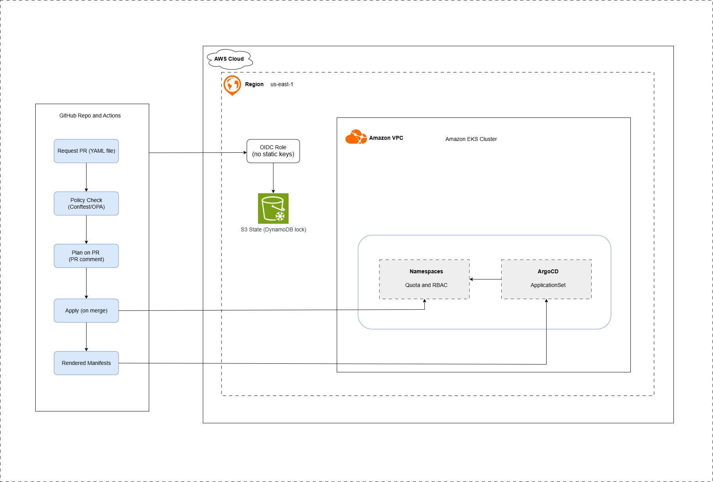
</p>

## Repo layout

<p align="center">
  
</p>

## How a developer requests a namespace

1. Copy `environments/requests/team-alpha.yaml` as a template.
2. Fill in `team_name`, `environment`, resource limits, `owner_email`.
3. Open a PR. CI runs policy checks and posts a `terraform plan` on the PR.
4. On merge, CI applies the Terraform module and ArgoCD picks up the
   resulting Application automatically. No manual `kubectl` or
   `argocd app create` needed.

## Guardrails

- Max 8 CPU cores / 16Gi memory / 50 pods per self-service namespace
  (see `policy/request_policy.rego`).
- `owner_email` required for cost and ownership tracking.
- `prod` environment requests are blocked by policy by default.
  So, it is intended to require a manual approval step before being enabled
  (documented as a deliberate gap, see "Known limitations" below).
- Default-deny NetworkPolicy on every namespace, with an explicit
  allowlist for platform namespaces (ingress controller, monitoring).

## Prerequisites

- **No pre-existing EKS cluster required** — see `infra-bootstrap/` for
  a minimal, cheap cluster (with ArgoCD pre-installed) sized to spin
  up, demo, and tear down. Run that first if you do not have a live
  cluster.
- Terraform >= 1.6
- An S3 bucket + DynamoDB table for Terraform remote state locking, 
  run `infra-bootstrap/state-backend-setup/create-backend.sh` once to
  create both, shared (via separate keys) between `infra-bootstrap`'s
  state and this module's own state
- GitHub Actions secrets: `AWS_ROLE_ARN`, `EKS_CLUSTER_NAME`, `TF_STATE_BUCKET`

## Local usage

```bash
cp backend.hcl.example backend.hcl   # then fill in your real bucket/table names
terraform init -backend-config=backend.hcl

terraform plan -var="eks_cluster_name=<your-cluster-name>"
terraform apply -var="eks_cluster_name=<your-cluster-name>"

# after apply, render manifests for ArgoCD to sync from:
./scripts/render-manifests.sh
```

Requires AWS CLI credentials with `eks:*` permissions on the target
cluster (used by the Kubernetes provider's `exec` auth via
`aws eks get-token`), and `kubectl` + `yq` on PATH for the render script.

## Bridging Terraform and ArgoCD

ArgoCD has no native awareness of Terraform state, so after `terraform
apply`, CI runs `scripts/render-manifests.sh`, which exports each
provisioned namespace's live resources (namespace, quota, limits,
network policy, RBAC) as plain YAML under
`environments/rendered/<team>-<environment>/` and commits them. The
ApplicationSet's Git generator then syncs from that folder. So
ArgoCD's job stays "sync what is in Git," and Terraform stays the
source of truth for what actually gets created.

## Known limitations / roadmap

- `prod` approval gate is currently a hard policy block, not a real
  approval workflow. Next step is a GitHub Environments manual
  approval gate.
- The render script uses `kubectl` + `yq` to strip mutable/generated
  fields before committing. This is a reasonable v1 but a dedicated
  Terraform `local_file`/`kubernetes_manifest` export, or a real
  Terraform-ArgoCD bridge tool, would be more robust for a production
  setup.

## 📸 Screenshots
<p align="center">
    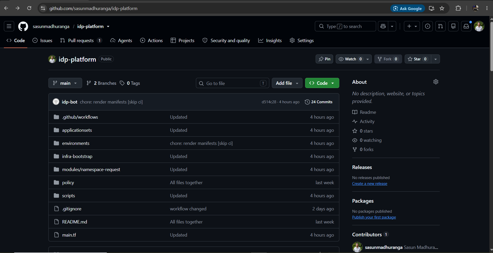
    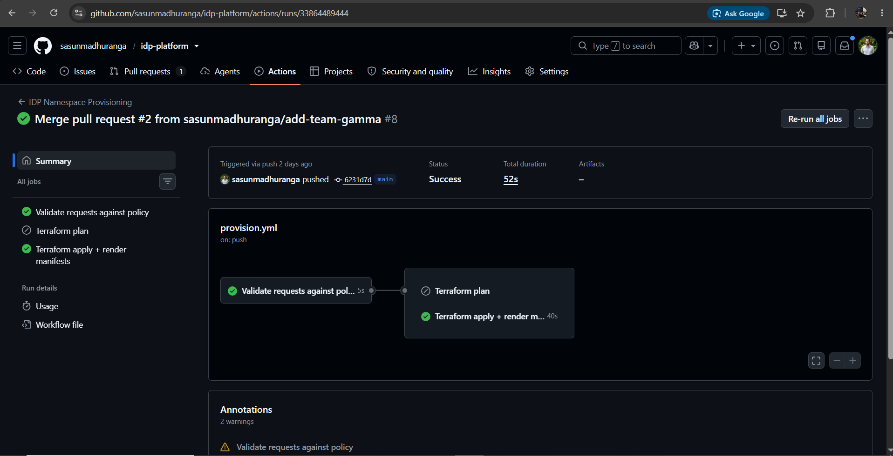
    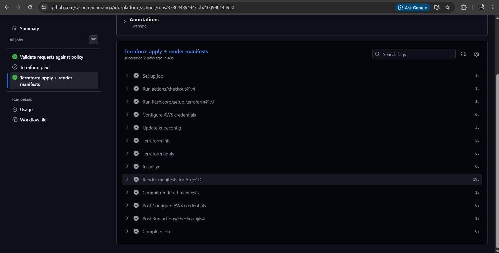
    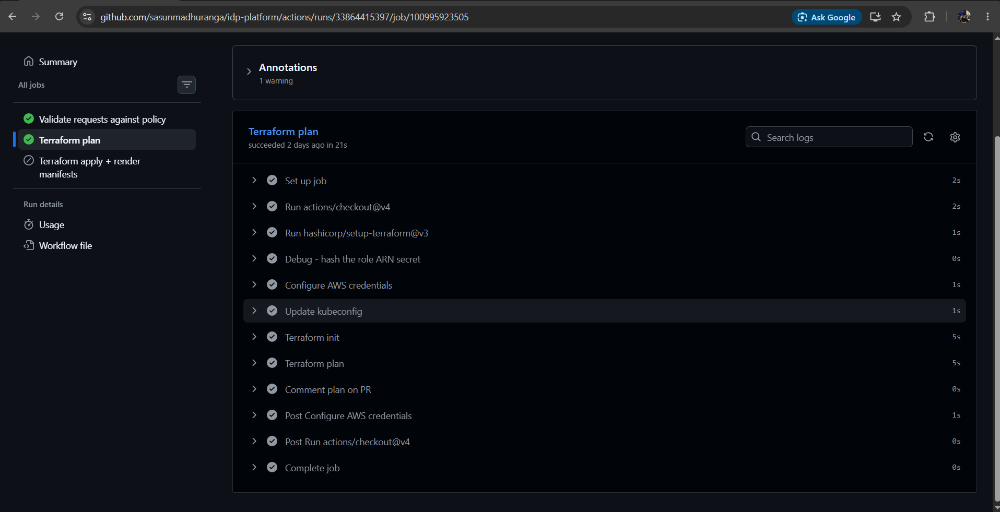
    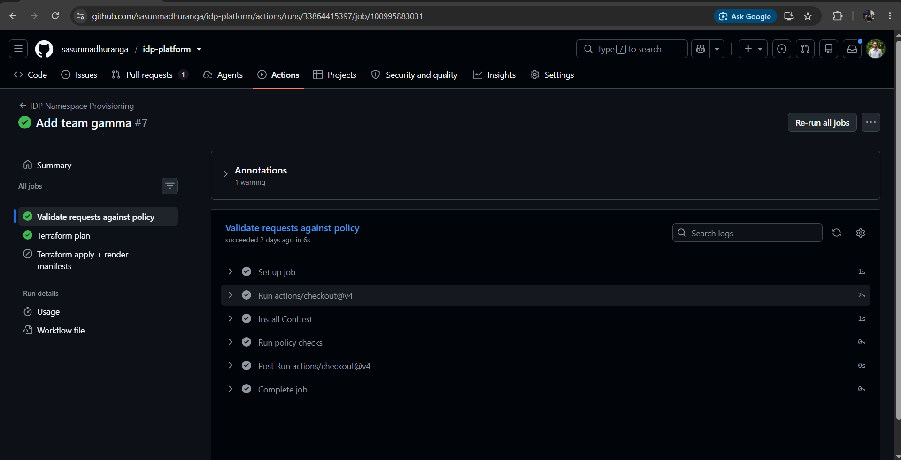
    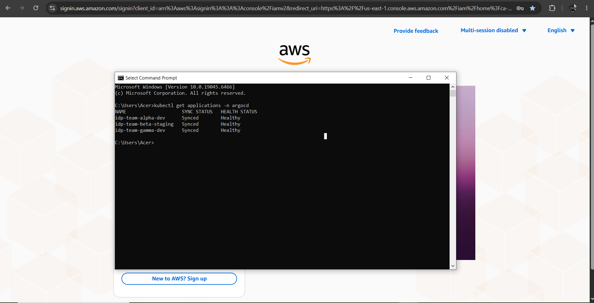
    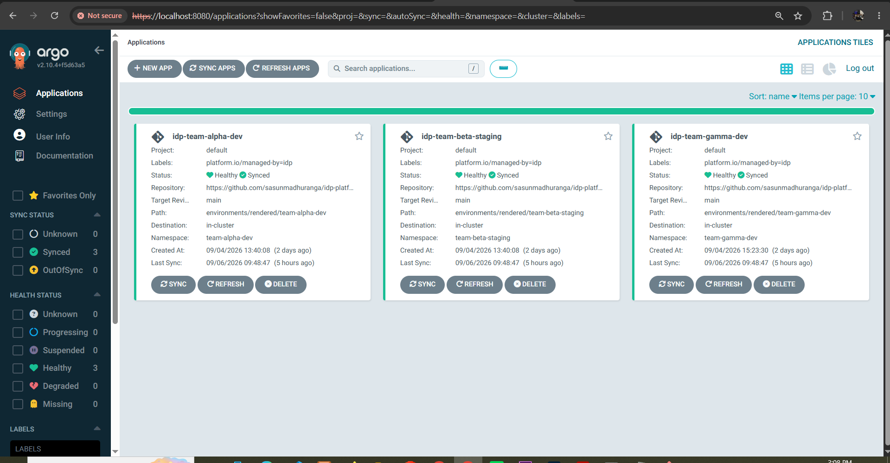
    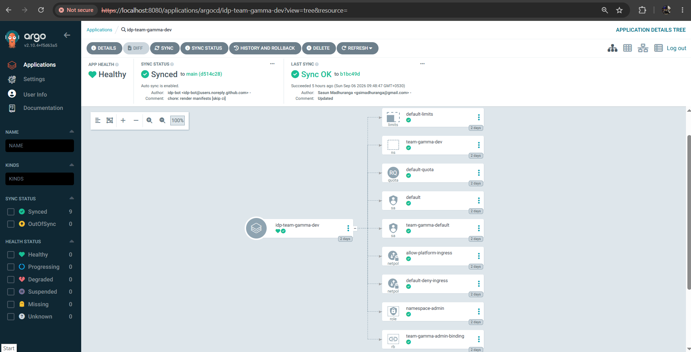
    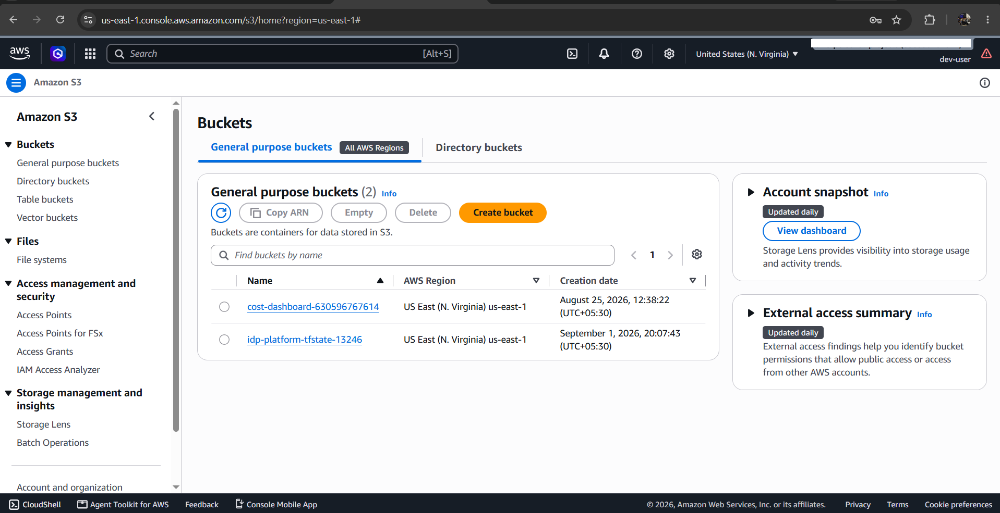
    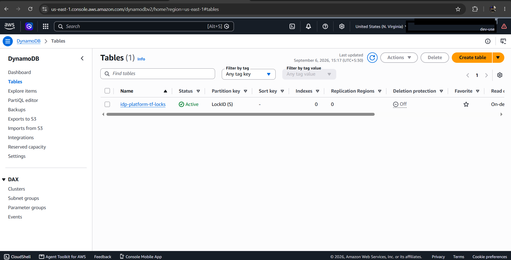
    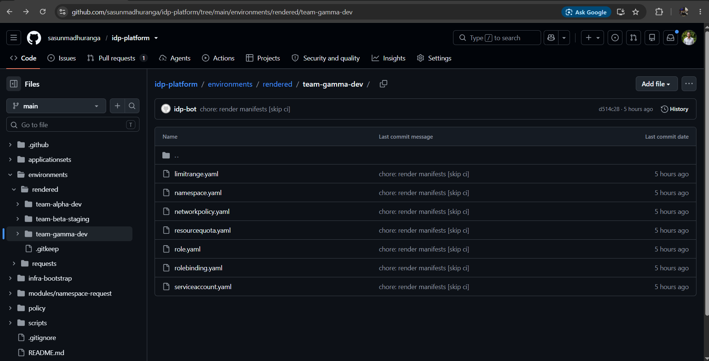
    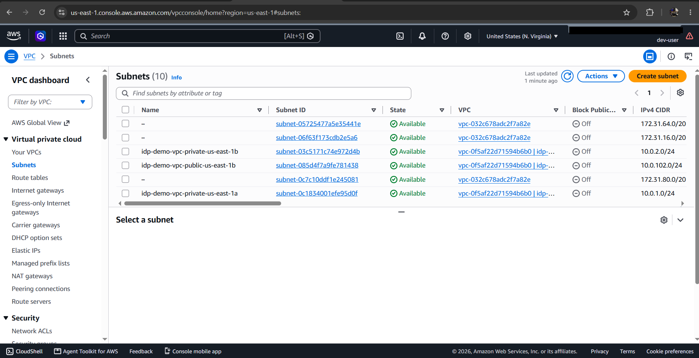
    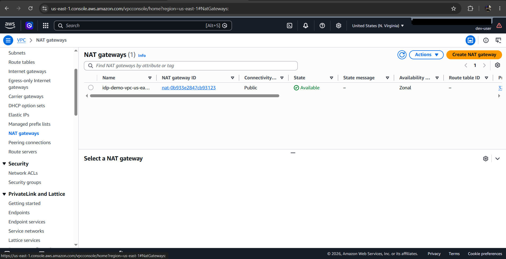
</p>

---

## Author
Sasun Madhuranga

GitHub: https://github.com/sasunmadhuranga